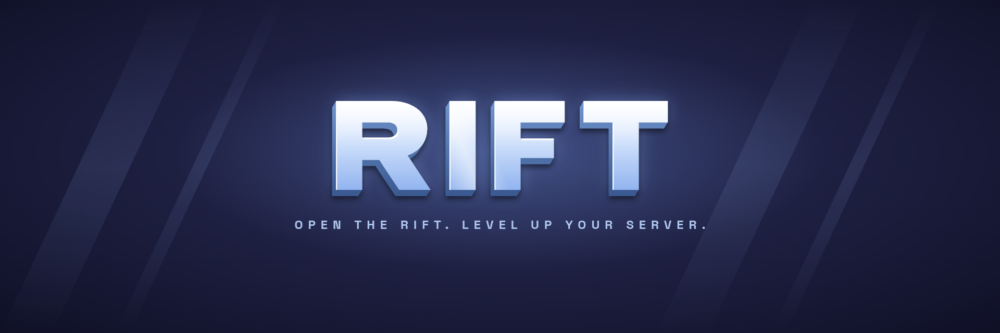

 

**Polished, reliable Minecraft plugins, built by server owners for server owners.**

---

## About

Rift Foundation is a Minecraft plugin development team focused on building polished, reliable tools for server owners.

We run and manage Minecraft communities ourselves, so we know what servers actually need. From gameplay systems to admin utilities, every plugin we make is designed to be easy to install, easy to configure, and enjoyable to use.

## What to Expect

| | |
|---|---|
| ⚡ **Lightweight & stable** | Built to run smoothly and stay out of the way of your server's performance. |
| ✨ **Consistent quality** | All our plugins share the same structure and style, so once you know one, you know them all. |
| 🛠️ **Server-owner mindset** | Features are built around what communities actually need. |

## Our Goal

To make powerful features simple to set up, simple to tweak, and a pleasure to run, so you can spend less time configuring and more time building your community.

## Support

Questions, bugs, or ideas? Reach out through our Discord server.

---

Made with care by Rift Foundation

